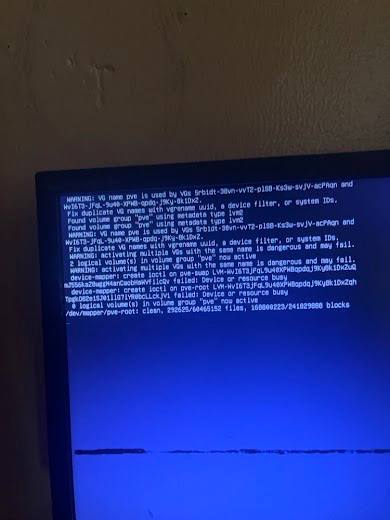
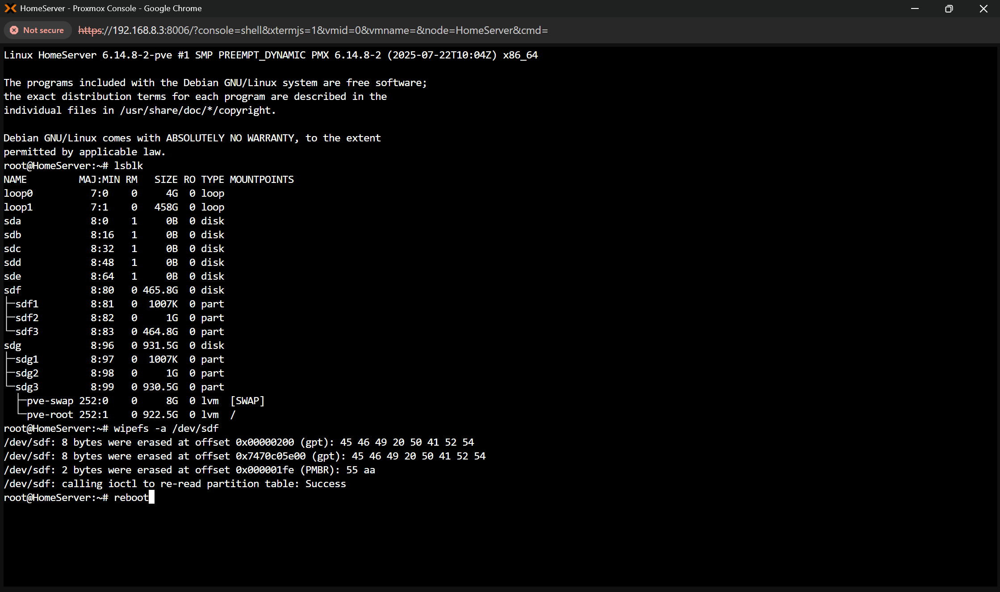
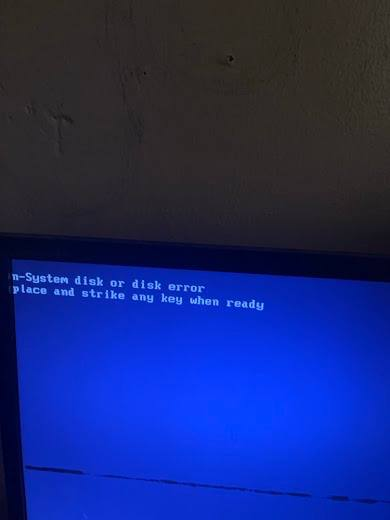
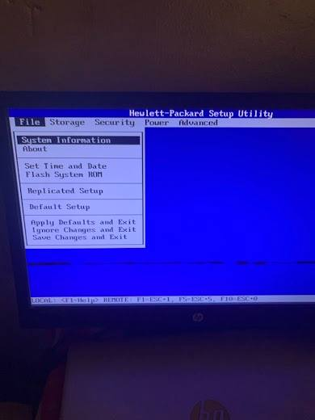
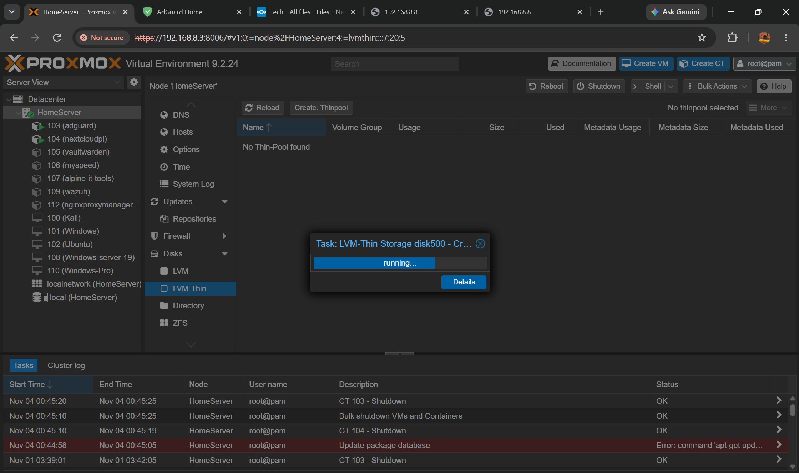
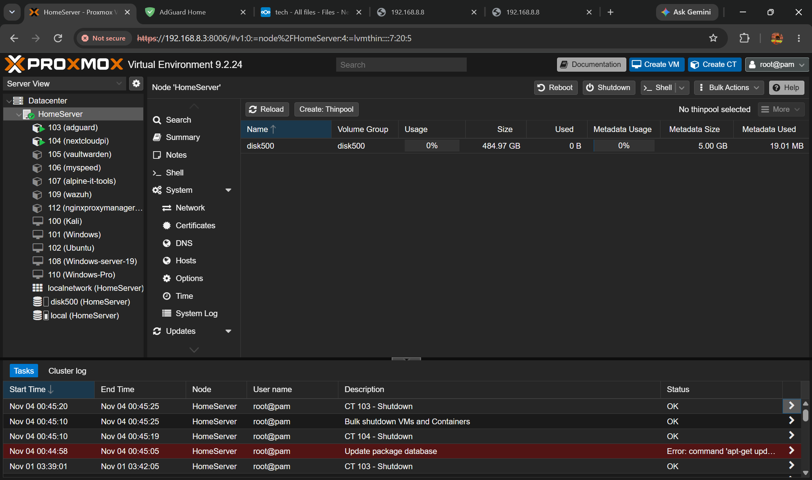

# 🛠️ HomeLab TroubleShooting Chronicles

[](https://www.proxmox.com)
[](https://www.debian.org)
[](https://kernel.org)
[](https://hp.com)
[](https://github.com/hannielcyber1/HomeLaB-TroubleShooting-Chronicles)

A curated collection of real-world post-mortems, incident runbooks, and diagnostic guides from maintaining and scaling a Proxmox-based HomeLab environment. 

Every chronicle records the exact failure conditions, diagnostic procedures, visual proof from console/BIOS, root causes, and verified fixes.

---

## 📑 Chronicles Index

| Chronicle ID | Date | Category | Topic / Issue | Severity | Status |
| :--- | :--- | :--- | :--- | :---: | :---: |
| [**#001**](chronicles/01-proxmox-duplicate-lvm-bios-boot/README.md) | Nov 2026 | Storage & BIOS | **[Proxmox Duplicate LVM Volume Group (`pve`) & HP BIOS Boot Failure](chronicles/01-proxmox-duplicate-lvm-bios-boot/README.md)** | High | `RESOLVED` |

---

## 🖥️ Homelab Environment Baseline

* **Host Node:** `HomeServer`
* **Virtualization Layer:** Proxmox Virtual Environment 9.2.24
* **Hardware Platform:** HP Desktop Workstation (Legacy BIOS / HP Setup Utility)
* **Storage Configuration:**
  * **Primary OS:** 1.0 TB HDD (`/dev/sdg` / `sda`) – Proxmox Root & Swap
  * **Secondary Pool:** 500 GB HDD (`/dev/sdf` / `sdb`) – Provisioned as LVM-Thin (`disk500`)
* **Running Services & Workloads:**
  * **Core Infrastructure:** AdGuard Home (`CT 103`), NextcloudPi (`CT 104`), Vaultwarden (`CT 105`), MySpeed (`CT 106`), Alpine IT-Tools (`CT 107`), Nginx Proxy Manager (`CT 112`)
  * **Security & Testing:** Wazuh SIEM (`CT 109`), Kali Linux (`VM 100`)
  * **Lab Systems:** Ubuntu (`VM 102`), Windows Server 2019 (`VM 108`), Windows Pro (`VM 110`)

---

## ⚡ Featured Chronicle Preview

### [Chronicle #001: Duplicate LVM Volume Groups & HP BIOS Boot Order](chronicles/01-proxmox-duplicate-lvm-bios-boot/README.md)

When adding a secondary 500 GB drive previously used in another Proxmox node, two distinct cascading issues arose:
1. **LVM Name Collision:** Both disks had a volume group named `pve`, generating multiple kernel warnings:
   ```text
   WARNING: VG name pve is used by VGs <UUID1> and <UUID2>.
   device-mapper: create ioctl on pve-root failed: Device or resource busy
   ```
2. **BIOS "Non-System Disk" Error:** After clearing the drive headers using `wipefs -a /dev/sdf`, the HP workstation attempted to boot from the secondary drive first:
   ```text
   Non-System disk or disk error
   replace and strike any key when ready
   ```

#### Visual Chronicle Gallery:

| 1. Boot Warning | 2. CLI `wipefs` Cleanup | 3. BIOS Non-System Disk |
| :---: | :---: | :---: |
|  |  |  |
| **4. HP BIOS Setup** | **5. LVM-Thin Creation** | **6. Operational Pool** |
|  |  |  |

👉 **[Read the Full Step-by-Step Incident Chronicle & Runbook](chronicles/01-proxmox-duplicate-lvm-bios-boot/README.md)**

---

## 📂 Repository Organization

```text
HomeLaB-TroubleShooting-Chronicles/
├── README.md                                             # Main project portal & index
├── Homelab_Troubleshooting_Guide.md                      # Standalone quick reference guide
├── chronicles/                                           # Illustrated post-mortems & walkthroughs
│   └── 01-proxmox-duplicate-lvm-bios-boot/
│       ├── README.md                                     # Chronicle deep-dive & resolution runbook
│       └── images/                                       # High-res diagnostic screenshots & photos
│           ├── 01-lvm-duplicate-vg-warning.jpg
│           ├── 02-lsblk-wipefs-disk-wipe.png
│           ├── 03-hp-bios-non-system-disk-error.jpg
│           ├── 04-hp-setup-utility-boot-menu.jpg
│           ├── 05-pve-lvm-thinpool-creation.png
│           └── 06-pve-lvm-thinpool-active.png
└── docs/
    └── incident-template.md                              # Standard template for documenting new issues
```

---

## 📝 Documenting Future Incidents

To log a new incident, copy the template from [`docs/incident-template.md`](docs/incident-template.md):

```bash
mkdir -p chronicles/XX-incident-title/images
cp docs/incident-template.md chronicles/XX-incident-title/README.md
```

Follow the structure:
1. Executive Summary & Architecture Diagram
2. Symptoms & Hardware Baseline
3. Root Cause Analysis
4. Step-by-Step Remediation Runbook with visual evidence
5. Prevention Checklist
