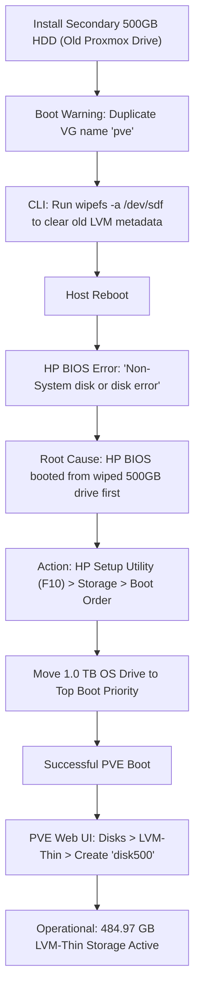
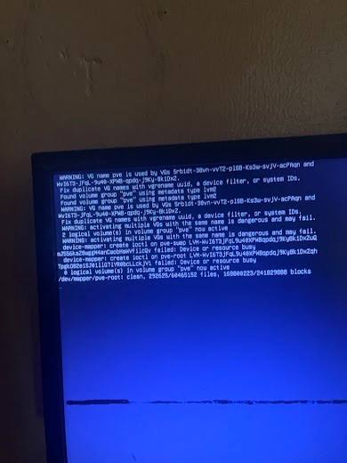
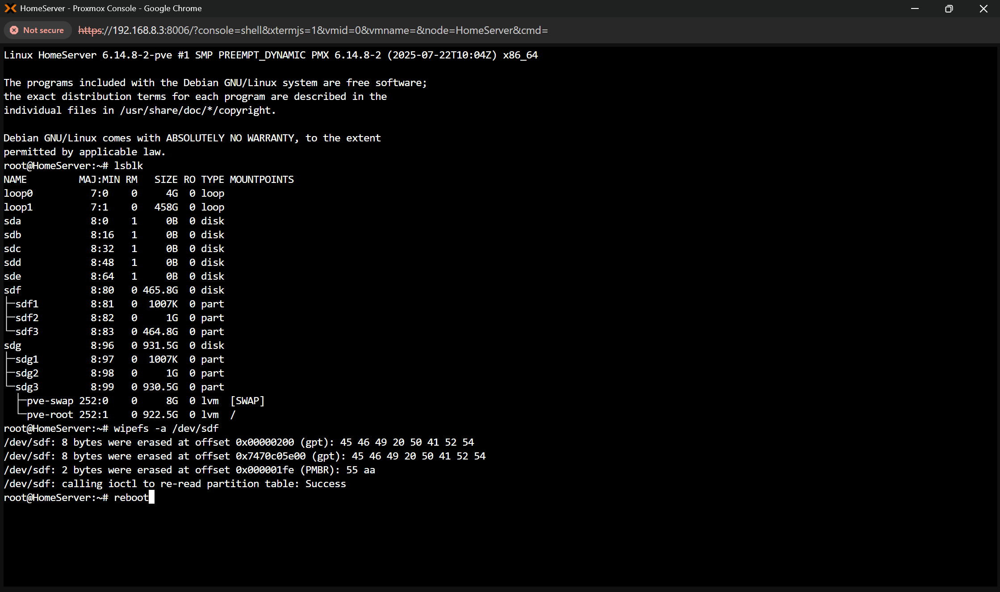
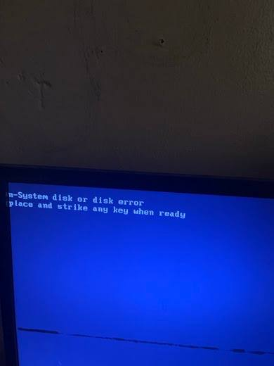
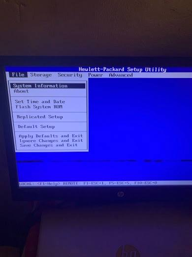
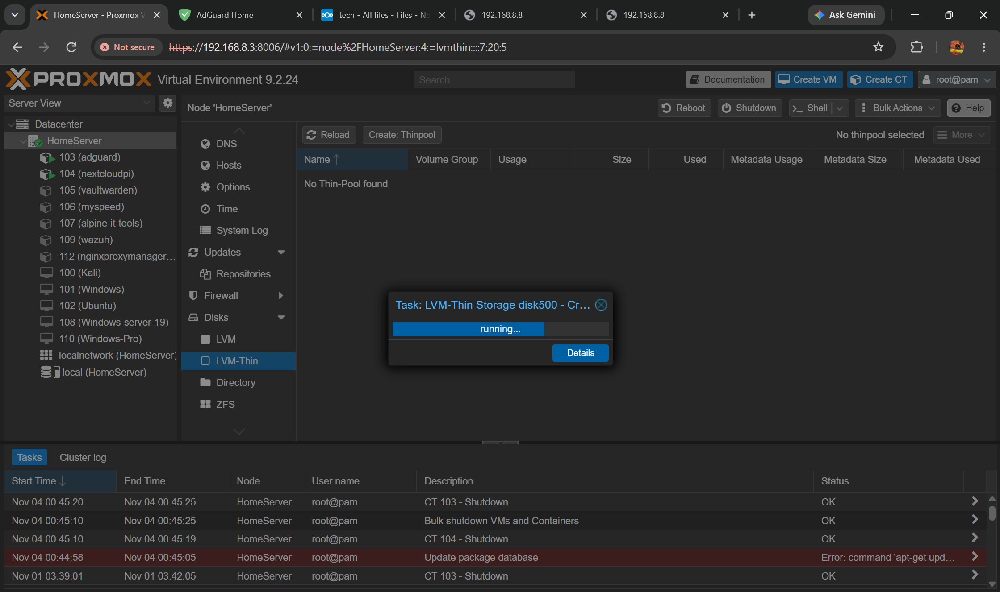
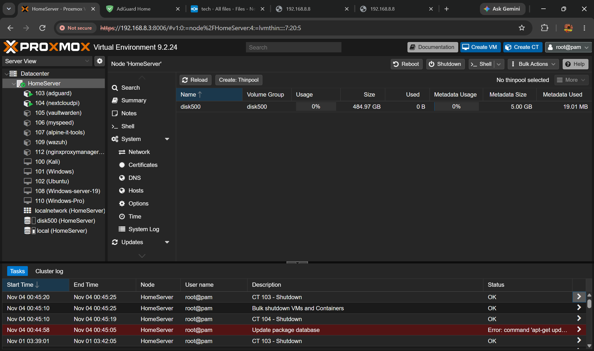

# Chronicle #001: Resolving Duplicate LVM VGs & HP BIOS Boot Sequence Failure

> **Incident ID:** `INC-20261107-PVE01`  
> **Target Node:** `HomeServer`  
> **Environment:** Proxmox VE 9.2.24 (Kernel 6.14.8-2-pve)  
> **Hardware:** HP Desktop Workstation (Legacy BIOS / HP Setup Utility)  
> **Category:** Storage / LVM / Hardware BIOS Boot  
> **Severity:** High (Boot Failure & LVM Metadata Conflict)  
> **Status:** Resolved  

---

## 📌 Executive Summary

During storage maintenance and reconfiguration on a Proxmox VE host (`HomeServer`), a secondary 500 GB hard drive from an older Proxmox deployment was installed alongside the existing 1 TB system drive. This led to a multi-stage failure:

1. **LVM Collision:** Proxmox reported duplicate Volume Group names (`pve`), causing device-mapper activation warnings and device busy errors during boot.
2. **BIOS Boot Hang:** Upon wiping the partition table of the secondary drive using `wipefs`, the host HP motherboard failed to boot into Proxmox, halting with `Non-System disk or disk error replace and strike any key when ready`.
3. **Recovery & Provisioning:** BIOS boot priority was corrected, restoring system access, and the secondary disk was initialized as an LVM-Thin pool (`disk500`) for virtual machine and container block storage.



---

## 🖥️ System & Hardware Baseline

| Component | Detail / Specification | Role |
| :--- | :--- | :--- |
| **Node Hostname** | `HomeServer` | Hypervisor Node |
| **Platform** | Proxmox VE 9.2.24 | Debian 12 (Bookworm) based |
| **Kernel** | `Linux 6.14.8-2-pve #1 SMP PREEMPT_DYNAMIC` | PVE Custom Kernel |
| **Hardware** | HP Workstation / Desktop Series | Host System |
| **Primary Disk** | 1.0 TB HDD (`/dev/sdg` or `/dev/sda`) | PVE System (`pve-root`, `pve-swap`, EFI/PMBR) |
| **Secondary Disk** | 500 GB HDD (`/dev/sdf` / `WDC WD5000AAKX`) | Target drive for secondary VM storage (`disk500`) |

---

## 🔍 Stage 1: The Incident & Symptoms

### Symptom 1: Duplicate Volume Group (`pve`) Metadata Warning

When the server booted up with both drives connected, Proxmox kernel initialization paused with multiple warning banners:

```text
WARNING: VG name pve is used by VGs 5rbIdt-30vn-vvT2-p1S0-Ks3w-svjv-acPAQn and WvI6T3-JFqL-9u40-XPWB-qpdq-j9Ky-8k1Dx2.
Fix duplicate VG names with vgrename uuid, a device filter, or system IDs.
Found volume group "pve" using metadata type lvm2
Found volume group "pve" using metadata type lvm2
WARNING: activating multiple VGs with the same name is dangerous and may fail.
device-mapper: create ioctl on pve-swap LVM-WvI6T3... failed: Device or resource busy
device-mapper: create ioctl on pve-root LVM-WvI6T3... failed: Device or resource busy
```



#### Root Cause Analysis:
When Proxmox is installed, the default volume group is always designated `pve`. Because the newly attached 500 GB drive had an old Proxmox installation, both disks presented active LVM Physical Volumes (PVs) containing Volume Groups named `pve`. During `vgscan` and auto-activation at boot, LVM detected identical VG names across different UUIDs, triggering a device-mapper conflict.

---

## 🛠️ Stage 2: Purging Legacy Metadata via Shell

To eliminate the conflict, the secondary drive needed its partition table and LVM signatures scrubbed.

1. **Verify Block Device Mapping:**
   Inside the Proxmox web shell or SSH terminal, inspect drive letters:
   ```bash
   lsblk
   ```
   *Expected Layout:*
   * `sdg` (1.0 TB): Contains `sdg1`, `sdg2`, and `sdg3` (`pve-root` mounted on `/`, `pve-swap`).
   * `sdf` (500 GB): Secondary drive with stale partitions `sdf1`, `sdf2`, and `sdf3`.

   > [!CAUTION]
   > Ensure you target the correct device identifier. Running `wipefs` on the primary drive will destroy the operating system!

2. **Wipe Signatures with `wipefs`:**
   Erase all filesystem, GPT, and MBR signatures across the secondary device `/dev/sdf`:
   ```bash
   wipefs -a /dev/sdf
   ```

   *Terminal output received:*
   ```text
   /dev/sdf: 8 bytes were erased at offset 0x00000200 (gpt): 45 46 49 20 50 41 52 54
   /dev/sdf: 8 bytes were erased at offset 0x7470c05e00 (gpt): 45 46 49 20 50 41 52 54
   /dev/sdf: 2 bytes were erased at offset 0x000001fe (PMBR): 55 aa
   /dev/sdf: calling ioctl to re-read partition table: Success
   ```

   

3. Reboot host:
   ```bash
   reboot
   ```

---

## ⚠️ Stage 3: BIOS Boot Failure ("Non-System disk or disk error")

Following the reboot command, the screen failed to load GRUB/systemd-boot and halted on:

```text
Non-System disk or disk error
replace and strike any key when ready
```



### Why Did This Occur?
* In older HP workstations and desktop BIOS configurations, hard drive boot precedence is determined either by physical SATA port numbering or hardcoded BIOS device priority.
* Previously, the 500 GB drive had an active MBR/bootloader. Even though `sdg` was the desired OS disk, the HP BIOS checked the secondary drive first.
* Once `wipefs` erased the PMBR signature (`0x000001fe: 55 aa`), the BIOS encountered an unbootable disk on its top-priority storage channel and threw the classic `Non-System disk or disk error` rather than automatically falling back to the next drive.

---

## 🔧 Stage 4: Restoring HP BIOS Boot Order

### Method 1: HP Setup Utility (Permanent Fix)
1. Power on the HP machine and tap <kbd>F10</kbd> continuously to access the **Hewlett-Packard Setup Utility**.
2. Use arrow keys to select the **Storage** menu.

   

3. Navigate to **Boot Order** (or **Hard Drive Order** / **Integrated SATA**).
4. Inspect the order of the drives:
   * Move the **1.0 TB Primary Proxmox OS Drive** to the top position using <kbd>F6</kbd> (Move Up) or <kbd>F5</kbd> (Move Down).
   * Position the **500 GB Drive** below the primary drive.
5. Press <kbd>F10</kbd> to accept changes.
6. Navigate to **File** > **Save Changes and Exit**.

### Method 2: One-Time Boot Menu (<kbd>F9</kbd>)
* Alternatively, tap <kbd>F9</kbd> at post to open the HP Boot Menu and manually pick the 1 TB drive to boot into Proxmox.

---

## 🚀 Stage 5: Provisioning the Disk in Proxmox VE (LVM-Thin)

Once Proxmox booted successfully, the wiped 500 GB drive was ready to be initialized into the storage pool.

1. Navigate to **Proxmox Web UI** (`https://<host-ip>:8006`).
2. Select **Node (`HomeServer`)** > **Disks**.
3. Locate the 500 GB drive (now assigned `/dev/sdb` or `/dev/sdf`) and verify it shows as **GPT: No** or **Clean**.
4. Click **Initialize Disk with GPT**.
5. Navigate to **Node (`HomeServer`)** > **Disks** > **LVM-Thin**.
6. Click **Create: Thinpool**:
   * **Disk:** Select `/dev/sdb` (500 GB `WDC WD5000AAKX`).
   * **Name:** `disk500`

   

7. Proxmox will execute the task in the background (`LVM-Thin Storage disk500 - Create`).
8. After completion, `disk500` appears with **484.97 GB** total capacity and **0%** usage, ready for Virtual Machine & Container disks with full snapshot support.

   

---

## 💡 Key Takeaways & Best Practices

| Area | Best Practice |
| :--- | :--- |
| **LVM Disk Re-use** | Always run `wipefs -a /dev/sdX` or `pvremove /dev/sdX` **before** rebooting when re-purposing drives with legacy Proxmox installs to prevent `pve` VG namespace collisions. |
| **HP BIOS Quirks** | Many HP desktop/workstation BIOS firmware will halt on unbootable top-priority SATA drives rather than descending through lower priority devices. Always enforce boot priority after disk modifications. |
| **Storage Architecture** | Use **LVM-Thin** for VM/LXC disks to enable fast live snapshots and thin provisioning. Use **Directory (ext4/xfs)** for ISOs, templates, and full backup files. |
| **Device Naming** | Note that Linux device letters (`/dev/sda`, `/dev/sdb`, `/dev/sdf`) can shift across reboots based on device discovery timings. Always rely on UUIDs or LVM VG names rather than hardcoded device letters. |

---

## 🛠️ Verification Checklist

- [x] Host boots cleanly without duplicate `pve` VG warnings.
- [x] BIOS boot priority boots directly to primary OS drive.
- [x] Storage `disk500` appears in PVE GUI tree under Datacenter.
- [x] Snapshot capability verified on `disk500` for guest VMs and LXCs.
