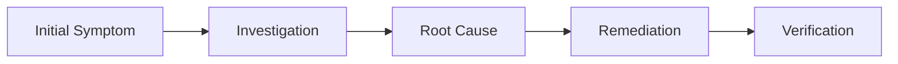

# Chronicle #XXX: [Descriptive Title of the Issue]

> **Incident ID:** `INC-YYYYMMDD-XXX`  
> **Target Node / Host:** `NodeName`  
> **Environment:** Proxmox VE / Linux / Docker / Kubernetes  
> **Hardware:** Hardware details (CPU, Motherboard, Storage)  
> **Category:** [Networking | Storage | Virtualization | Hardware | Security]  
> **Severity:** [Low | Medium | High | Critical]  
> **Status:** [Investigating | Resolved | Workaround]  

---

## 📌 Executive Summary
A concise 2-3 sentence overview of what went wrong, what broke, and how it was solved.



---

## 🔍 Incident Timeline & Symptoms
- **Timestamp / Trigger:** When did the issue manifest?
- **Error Messages:**
  ```text
  [Insert exact error messages / log snippets here]
  ```
- **Observed Behavior:** What happened vs what was expected?

---

## 🔬 Root Cause Analysis
Explain the technical underpinnings:
- Why did this occur?
- What underlying Linux / Proxmox / hardware mechanisms were involved?

---

## 🛠️ Step-by-Step Resolution Runbook

### Phase 1: Diagnostics
```bash
# Diagnostic command
```

### Phase 2: Remediation
```bash
# Fix command
```

### Phase 3: Configuration & Verification
- [ ] Step 1
- [ ] Step 2

---

## 💡 Key Lessons & Prevention
- What can be done to prevent this in the future?
- Useful cheatsheets or commands.
